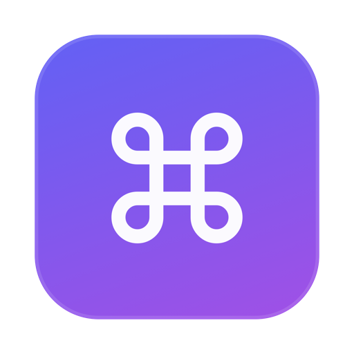
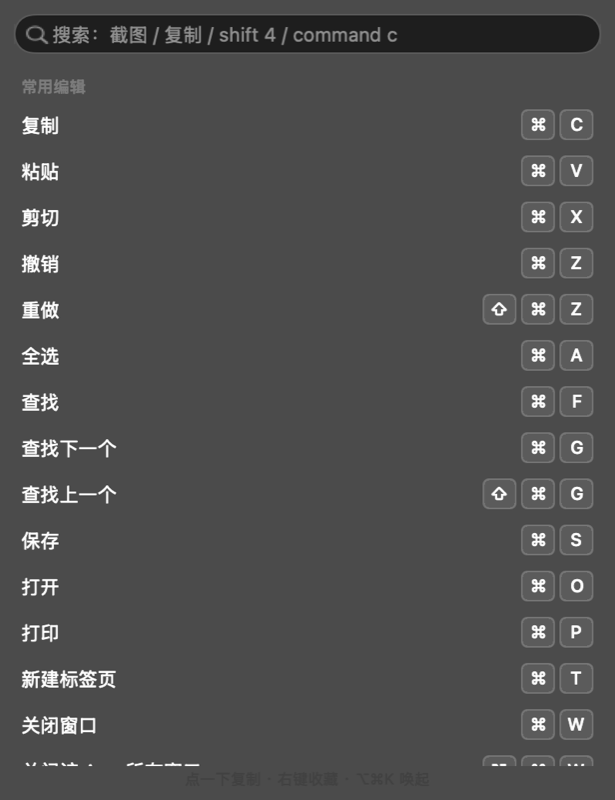
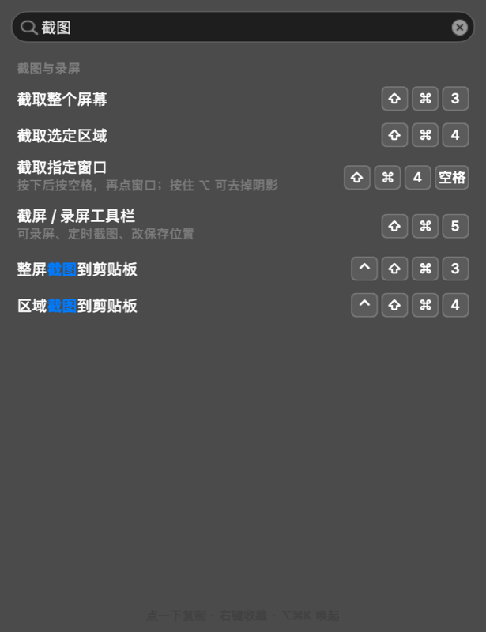

# KeyCheats · 快捷键速查



**A 200 KB native macOS menu-bar app that answers one question: "what was that shortcut again?"**

Lives in your menu bar, opens with `⌥⌘K`, searchable in Chinese / pinyin / English key names, click any row to copy the key combo. No Dock icon, no accessibility permission, no telemetry, no dependencies.

[中文说明 ↓](#中文)



## Why another shortcut app?

Most existing tools (CheatSheet, KeyCue, shortcutlens) work by **holding ⌘ to reveal the frontmost app's menu shortcuts**. That is great for app-specific commands, but:

- they need **Accessibility permission** and read other apps' menu bars;
- they only cover **the app you are currently in** — useless for "I want to switch desktops" or "how do I empty the Trash";
- KeyCue is **paid**, CheatSheet has been dormant for years;
- none of them are searchable in Chinese.

KeyCheats takes the opposite bet: **a small, curated, always-available cheat sheet of system-level shortcuts**, with search that actually works in Chinese.

| | KeyCheats | CheatSheet / KeyCue | shortcutlens |
|---|---|---|---|
| Zero permissions | ✅ | ❌ needs Accessibility | ❌ |
| System-level shortcuts | ✅ 86 entries | ⚠️ only frontmost app | ⚠️ only frontmost app |
| Chinese / pinyin search | ✅ | ❌ | ❌ |
| Click to copy key combo | ✅ | ❌ | ❌ |
| Footprint | 200 KB, ~60 MB RAM | larger | similar |
| Price | free, MIT | free / €19.99 | free |

## Features

- **Menu bar only** — no Dock icon, no window to manage. `LSUIElement` app.
- **`⌥⌘K` anywhere** — global hotkey via Carbon `RegisterEventHotKey`, no Accessibility prompt.
- **Search that forgives you** — type `截图`, `jietu`, `shift 4`, `command c`, or `废纸篓`. Multi-word queries are AND-ed. Matched text is highlighted.
- **Click = copy** — every row copies its key combo (`⇧⌘4`), so you can paste it into your notes.
- **Favorites & recents** — right-click any row to pin it to the top; the last 6 you used float up automatically.
- **English copy** — right-click → `复制英文写法` gives `Command+Shift+4` for docs written in English.
- **Launch at login** — a LaunchAgent is installed on first run, toggleable from the menu bar right-click menu.
- **Dark / light** — follows the system appearance.

## Requirements

macOS 13+ (Ventura or later). Built and tested on macOS 26.

## Install

There is no signed binary yet, so build it yourself — it takes about five seconds and needs only the Xcode Command Line Tools (`xcode-select --install`).

```bash
git clone https://github.com/cheney03418-ctrl/keycheats.git
cd keycheats
./build.sh          # build + install to ~/Applications + relaunch
```

`./build.sh --build` builds only, without installing.

## Usage

| Action | How |
|---|---|
| Open the panel | Click the `⌘` in the menu bar, or press `⌥⌘K` |
| Search | Just start typing; `↑` `↓` to move, `↵` to copy, `esc` to close |
| Copy a shortcut | Click the row |
| Pin to top | Right-click a row → 收藏到顶部 |
| Copy English form | Right-click a row → 复制英文写法 |
| Quit / autostart | Right-click the menu bar icon |

## Add or fix a shortcut

All data lives in one array at the top of `main.swift`:

```swift
Shortcut(title: "截取选定区域", keys: ["⇧", "⌘", "4"], kw: "截图 截屏 screenshot area quyu"),
```

- `keys` — rendered as key caps and used as the copied text.
- `kw` — extra search aliases. **Add Chinese synonyms and pinyin here**, that is what makes search feel good.

Then run `./build.sh`.

Pull requests that add shortcuts, fix a wrong combo, or improve the keyword coverage are very welcome. Please cite an Apple support page or the app's own menu when you change an existing combo.

## Roadmap

- [ ] English UI (the shortcut data is Chinese-first today)
- [ ] Per-app shortcut packs (Finder, Xcode, VS Code…)
- [ ] Editable data file (`shortcuts.json`) so contributors do not need Swift
- [ ] Notarized release builds

## License

MIT — see [LICENSE](LICENSE).

---

# 中文

**200 KB 的原生 macOS 菜单栏小工具，只回答一个问题：那个快捷键是啥来着？**

常驻菜单栏，`⌥⌘K` 唤起，中文 / 拼音 / 英文键名都能搜，点一下就复制键位。没有 Dock 图标、不要辅助功能授权、不联网、无第三方依赖。



## 为什么还要再做一个

现成的方案（CheatSheet、KeyCue、shortcutlens）基本都是**按住 ⌘ 显示当前 App 的菜单快捷键**。做 App 内命令很好用，但有三个问题：

- 需要**辅助功能授权**，要去读别的 App 的菜单栏；
- 只覆盖**你当前所在的那个 App**——"怎么切换桌面""怎么清空废纸篓"这类系统级操作它管不到；
- KeyCue 收费（€19.99），CheatSheet 多年没更新，且没有一个能中文搜索。

KeyCheats 反过来做：**一份精选的、随时可查的系统级快捷键清单**，把中文搜索做扎实。

| | KeyCheats | CheatSheet / KeyCue | shortcutlens |
|---|---|---|---|
| 零权限 | ✅ | ❌ 需辅助功能 | ❌ |
| 系统级快捷键 | ✅ 86 条 | ⚠️ 仅当前 App | ⚠️ 仅当前 App |
| 中文 / 拼音搜索 | ✅ | ❌ | ❌ |
| 点击复制键位 | ✅ | ❌ | ❌ |
| 体积 | 200 KB / 约 60 MB 内存 | 更大 | 相近 |
| 价格 | 免费 MIT | 免费 / €19.99 | 免费 |

## 功能

- **只占菜单栏**——没有 Dock 图标，没有窗口要管。
- **`⌥⌘K` 随时唤起**——用 Carbon 注册全局热键，不弹辅助功能授权。
- **搜索很宽容**——`截图`、`jietu`、`shift 4`、`command c`、`废纸篓` 都行，多个词是「且」的关系，命中的字会高亮。
- **点一下就是复制**——复制出 `⇧⌘4` 这样的键位，可以直接粘到笔记里。
- **收藏与最近使用**——右键任意一行收藏到顶部；最近用过的 6 条会自动浮上来。
- **英文写法**——右键「复制英文写法」得到 `Command+Shift+4`，写英文文档时用得上。
- **开机自启**——首次运行自动写入 LaunchAgent，可在右键菜单里关掉。
- **深色 / 浅色**——跟随系统。

## 安装

目前没有签名好的二进制，自己编译即可，只需要装了命令行工具（`xcode-select --install`）：

```bash
git clone https://github.com/cheney03418-ctrl/keycheats.git
cd keycheats
./build.sh          # 编译 + 安装到 ~/Applications + 重启
```

只想编译不安装：`./build.sh --build`。

## 用法

| 操作 | 方式 |
|---|---|
| 打开面板 | 点菜单栏的 `⌘`，或按 `⌥⌘K` |
| 搜索 | 直接打字；`↑` `↓` 选择，`↵` 复制，`esc` 关闭 |
| 复制键位 | 点那一行 |
| 收藏置顶 | 右键行 → 收藏到顶部 |
| 复制英文写法 | 右键行 → 复制英文写法 |
| 退出 / 自启 | 右键菜单栏图标 |

## 加一条 / 改一条

所有数据都在 `main.swift` 顶部的数组里：

```swift
Shortcut(title: "截取选定区域", keys: ["⇧", "⌘", "4"], kw: "截图 截屏 screenshot area quyu"),
```

- `keys`：渲染成键帽，也是复制出来的内容。
- `kw`：额外的搜索别名。**中文同义词和拼音都加在这里**，搜索好不好用全看它。

改完跑 `./build.sh`。欢迎 PR 补充快捷键、修正错误、完善关键词；改动已有键位时请附上 Apple 官方文档或 App 自身菜单作为依据。
